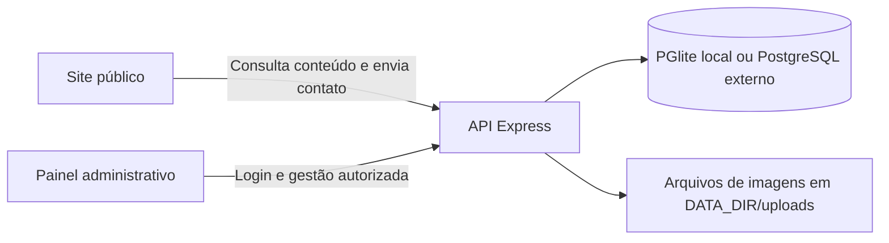

# EEAFR — Site institucional e painel administrativo

Projeto da **Escola Estadual Antônio Francisco Redondo**, desenvolvido com HTML, CSS e JavaScript, com backend Node.js, API REST, banco persistente e painel administrativo integrado.

O site apresenta a escola à comunidade. O painel permite à equipe atualizar os conteúdos e acompanhar as mensagens enviadas pelo formulário de contato.

**Documentação:** [Publicação na Hostinger VPS](deploy/HOSTINGER.md) · [Backend e API](projeto-TCC/backend/README.md) · [Configuração de ambiente](projeto-TCC/backend/.env.example) · [Licença MIT](LICENSE)

## Sumário

- [Instalação e execução](#instalacao)
- [Primeiro acesso administrativo](#primeiro-acesso)
- [Páginas e funcionalidades](#funcionalidades)
- [Como usar o painel](#painel)
- [Integração entre site, API e banco](#integracao)
- [Tecnologias e estrutura](#estrutura)
- [Comandos disponíveis](#comandos)
- [Configuração do banco](#banco)
- [PostgreSQL local no Windows](#postgres-local)
- [Testes e verificações](#testes)
- [Publicação e backup](#publicacao)
- [Problemas comuns](#problemas)
- [Escopo e manutenção](#escopo)

<a id="instalacao"></a>

## Instalação e execução

### Requisitos

- Node.js **22 ou superior**, com npm.
- Navegador atualizado para acessar o site e o painel.
- Acesso à internet na instalação das dependências. Fontes e mapa também utilizam serviços externos.
- Microsoft Edge instalado para executar os testes de navegador na configuração padrão.

Uma instalação sem configuração de banco usa **PGlite**, um PostgreSQL embutido no processo Node.js. O projeto também inclui instalação gerenciada de **PostgreSQL 18.6 para Windows**, com migração dos dados e inicialização automática. Veja [PostgreSQL local](#postgres-local).

### Início rápido pela raiz do projeto

Abra um terminal na pasta que contém este README e o `package.json` principal:

```powershell
node --version
npm --version
npm run setup
npm start
```

`npm run setup` instala as dependências do backend a partir do arquivo de versões travadas. `npm start` inicia a API e serve o site e o painel juntos.

| Acesso local padrão | Endereço |
| --- | --- |
| Site público | [http://localhost:3000](http://localhost:3000) |
| Painel administrativo | [http://localhost:3000/admin/](http://localhost:3000/admin/) |
| Verificação da API e do banco | [http://localhost:3000/api/health](http://localhost:3000/api/health) |

Mantenha o terminal aberto enquanto usa a aplicação. Para encerrar o servidor, pressione **Ctrl+C**. Para desenvolvimento com reinício automático do backend:

```powershell
npm run dev
```

Abra as páginas pelo endereço HTTP do servidor. Abrir `index.html` diretamente pelo explorador de arquivos não disponibiliza a API nem o painel integrado.

### Configuração opcional

O arquivo de configuração fica em `projeto-TCC/backend/.env`. Para criar um a partir do modelo, **somente se ainda não existir**:

```powershell
Copy-Item projeto-TCC/backend/.env.example projeto-TCC/backend/.env
```

O modo local funciona com os padrões do código. Consulte a [tabela completa das variáveis](projeto-TCC/backend/README.md#ambiente) antes de alterar porta, banco ou ambiente de produção. Reinicie o servidor após modificar a configuração.

<a id="primeiro-acesso"></a>

## Primeiro acesso administrativo

Na primeira inicialização de um banco sem usuários, o backend cria uma conta administradora.

1. Inicie o servidor com `npm start`.
2. Se não definiu `ADMIN_PASSWORD`, abra `projeto-TCC/backend/.data/primeiro-acesso.txt` no seu computador.
3. Use o e-mail e a senha desse arquivo em `/admin/`.
4. No painel, entre em **Minha conta** e troque a senha.
5. Faça login novamente com a nova senha.

O e-mail local padrão é `admin@eeafr.local`; a senha é gerada aleatoriamente. O arquivo registra apenas o acesso inicial: ele não é atualizado quando a senha muda. Se você definiu `ADMIN_PASSWORD`, use as credenciais configuradas; o arquivo não é gerado nesse caso.

`ADMIN_EMAIL` e `ADMIN_PASSWORD` só são usados na criação inicial da conta. Alterá-los depois não redefine usuários existentes. Se usar `DATA_DIR`, procure o arquivo de primeiro acesso nesse diretório.

O arquivo de credenciais, o `.env` e o banco são privados e não são servidos pelo site. Os caminhos locais de credenciais não são links públicos de acesso.

<a id="funcionalidades"></a>

## Páginas e funcionalidades

| Página | Conteúdo e comportamento |
| --- | --- |
| [Início](projeto-TCC/index.html) | Apresentação, gestores, cursos, indicadores e contatos; os dados vinculados são atualizados pela API. |
| [Cursos](projeto-TCC/pages/cursos.html) | Abas dinâmicas com apresentação, duração, turno, certificação, vagas, matriz curricular, habilidades e carreiras. |
| [Eventos](projeto-TCC/pages/eventos.html) | Eventos, calendário escolar, avisos e comunicados em abas distintas. |
| [Galeria](projeto-TCC/pages/galeria.html) | Fotos ordenadas, legendas, carregamento sob demanda e visualização ampliada. |
| [Corpo docente](projeto-TCC/pages/corpo-docente.html) | Professores organizados por Linguagem, Exatas, Humanas e Técnicos. |
| [Secretaria digital](projeto-TCC/pages/secretaria-digital.html) | Indicadores, identificação da escola, gestores, infraestrutura e links úteis. |
| [Contato](projeto-TCC/pages/contato.html) | Contatos da escola, mapa e formulário com protocolo após o recebimento da mensagem. |
| [Privacidade](projeto-TCC/pages/privacidade.html) | Descrição do uso das mensagens, da sessão administrativa e dos serviços externos. |
| [Erro 404](projeto-TCC/pages/404.html) | Página para endereços públicos não encontrados. |
| [Painel administrativo](projeto-TCC/admin/index.html) | Gestão do conteúdo, mensagens, contas e visão geral da atividade. |

Os links para arquivos acima servem para consultar o código. Para usar as funcionalidades, navegue pelo servidor local.

Também há menu mobile, botão de voltar ao topo, indicadores animados, estados de formulário e adaptação para telas menores.

<a id="painel"></a>

## Como usar o painel

### Perfis de acesso

| Permissão | Administrador | Editor |
| --- | --- | --- |
| Consultar a visão geral e a atividade recente | Sim | Sim |
| Criar, editar e excluir conteúdo institucional | Sim | Sim |
| Enviar imagens para a galeria | Sim | Sim |
| Ler, marcar e excluir mensagens | Sim | Sim |
| Alterar a própria senha | Sim | Sim |
| Cadastrar, editar e desativar contas | Sim | Não |

Os dois perfis têm acesso às mensagens da comunidade. Escolha o perfil de quem fará a gestão considerando essa responsabilidade.

### Visão geral

A dashboard mostra contagens reais do banco, mensagens recentes, quantidade de mensagens não lidas, distribuição do conteúdo, alterações recentes e atalhos para cadastro. A contagem de eventos inclui registros de evento e de calendário.

### Atualizar conteúdo

1. Escolha a seção no menu lateral.
2. Use **Adicionar registro** ou **Editar** em um item existente.
3. Preencha os campos e salve.
4. Abra ou recarregue a página pública correspondente para conferir.

O painel oferece busca, filtros nas seções com categorias e paginação de **10 registros por página**. A exclusão pede confirmação. Não há etapa de rascunho ou aprovação: salvar publica a alteração no banco usado pelo site.

| Seção | O que preencher |
| --- | --- |
| Cursos | Nome, apresentação, categoria, duração, turno, certificação, vagas e detalhes. Em matriz, habilidades e carreiras, use um item por linha. |
| Eventos e calendário | Título, descrição, data, horário, local, tipo e destaque. Use `evento` para a aba de eventos e `calendario` para a aba de calendário. |
| Avisos | Título, descrição, categoria, urgência e data de publicação. |
| Comunicados | Título, descrição, categoria e data de publicação. |
| Galeria | Título, descrição, imagem e ordem. Menores valores de ordem aparecem primeiro. |
| Corpo docente | Nome, área, disciplinas e iniciais. |
| Dados da escola | Identificador do campo e valor. Preserve os identificadores que já são utilizados pelas páginas. |

Os campos reconhecidos da escola incluem contatos, endereço, indicadores e nomes dos gestores. Criar um identificador novo não cria automaticamente um novo componente na página: é preciso vinculá-lo no frontend. Veja o [mapa de integração](projeto-TCC/backend/README.md#integracao).

### Fotos e mensagens

Na galeria, envie um arquivo **JPG, PNG ou WebP de até 5 MB**, ou informe o caminho de uma imagem original, como `imagens/Escola/Patio.jpeg`. O envio gera um caminho `/uploads/...`; salvar o registro associa a imagem à galeria. A exclusão do registro mantém o arquivo para evitar quebrar referências compartilhadas.

Em **Mensagens**, abra a solicitação, leia o conteúdo e marque como lida ou não lida. O formulário entrega a mensagem nessa caixa de entrada; ele não envia e-mail automaticamente.

### Usuários e senha

Administradores podem criar contas com perfil `admin` ou `editor`, alterar dados e desativar acessos. A desativação substitui a exclusão de contas. Um administrador não pode desativar a própria conta nem remover seu próprio perfil administrativo.

Novas senhas devem ter entre **12 e 200 caracteres**. A troca de senha e as alterações de conta revogam as sessões do usuário afetado. A sessão dura até oito horas; use **Sair da conta** ao terminar.

<a id="integracao"></a>

## Integração entre site, API e banco



- [js/data.js](projeto-TCC/js/data.js) consulta `/api` e preenche as seções públicas.
- [js/script.js](projeto-TCC/js/script.js) controla navegação, abas, efeitos e envio do contato.
- [admin/app.js](projeto-TCC/admin/app.js) gerencia a interface do painel e suas chamadas à API.
- [backend/resources.js](projeto-TCC/backend/resources.js) compartilha definições de campos entre os formulários administrativos e a validação do backend.
- [backend/api.js](projeto-TCC/backend/api.js) consulta e altera registros, aplicando autorização e auditoria.

Site, painel e API são servidos na **mesma origem**, normalmente `http://localhost:3000`. Não há uma segunda porta de frontend nem uma URL de API externa para configurar nesse modo.

Uma edição não é enviada em tempo real para páginas já abertas: recarregue a página pública para buscar os novos dados. Se a consulta pública falhar, o site mostra um aviso; o HTML pode continuar exibindo informações de referência do projeto.

<a id="estrutura"></a>

## Tecnologias e estrutura

| Camada | Tecnologias usadas |
| --- | --- |
| Interface | HTML5, CSS3, JavaScript sem framework, Fetch API |
| API | Node.js, Express, dotenv |
| Banco | PGlite para uso local; driver `pg` para PostgreSQL externo |
| Sessão e proteção HTTP | Crypto do Node.js, Helmet, express-rate-limit |
| Upload | Multer com armazenamento final em disco |
| Testes | Node Test Runner e Playwright |

```text
.
├── README.md                       Guia principal
├── package.json                    Atalhos de execução pela raiz
├── LICENSE
└── projeto-TCC/
    ├── index.html
    ├── CSS/style.css               Visual do site
    ├── js/
    │   ├── script.js               Interações e formulário
    │   └── data.js                 Integração pública com a API
    ├── imagens/                    Imagens originais da escola
    ├── pages/                      Páginas institucionais
    ├── admin/
    │   ├── index.html
    │   ├── style.css
    │   └── app.js
    └── backend/
        ├── README.md               Guia técnico e referência da API
        ├── package.json
        ├── package-lock.json       Versões instaladas pelo npm ci
        ├── .env.example            Modelo público de configuração
        ├── server.js               Inicialização e rotas de arquivos
        ├── api.js                  API REST
        ├── auth.js                 Autenticação e sessões
        ├── resources.js            Campos e validações
        ├── config/database.js      Conexão e transações
        ├── middleware/errorHandler.js
        ├── models/                 Schema e cargas versionadas
        ├── scripts/check.js        Verificação de sintaxe
        ├── tests/                  Testes HTTP da API
        ├── browser-tests/          Testes de interface
        ├── playwright.config.js
        └── .data/                  Gerado localmente; não versionar
```

<a id="comandos"></a>

## Comandos disponíveis

Execute os comandos abaixo **na raiz**:

| Comando | Função |
| --- | --- |
| `npm run setup` | Instala dependências do backend com `npm ci`. |
| `npm start` | Inicia site, API e painel. |
| `npm run dev` | Inicia com `node --watch`, reiniciando o backend ao alterar código. |
| `npm run check` | Verifica a sintaxe dos arquivos JavaScript do projeto. |
| `npm test` | Executa os testes de integração da API. |
| `npm run test:browser` | Executa os testes de interface. |
| `npm run db:setup` | Instala/prepara o PostgreSQL local no Windows e cria banco e usuários. |
| `npm run db:migrate` | Com o site parado, transfere o PGlite para um destino vazio, verifica integridade e ativa PostgreSQL no `.env`. |
| `npm run db:start` | Inicia o PostgreSQL local sem iniciar o site. |
| `npm run db:status` | Verifica a conexão e mostra banco, usuário, porta e versão sem expor senhas. |
| `npm run db:stop` | Encerra o PostgreSQL local; pare o site antes. |
| `npm run db:backup` | Cria dump PostgreSQL e copia os uploads existentes para `.data/backups`. |
| `npm run deploy:package` | Gera pacote de código para envio ao VPS, sem banco ou credenciais. |
| `npm run deploy:export` | Gera pacote privado do PostgreSQL local e dos uploads para importação no VPS. |
| `npm run deploy:configure -- --domain DOMINIO --email EMAIL --admin-email EMAIL` | Gera configuração e secrets de produção; use no ambiente de destino. |

Também é possível trabalhar diretamente em `projeto-TCC/backend`: nessa pasta, instale com `npm ci` e utilize `npm start`, `npm run dev`, `npm run check`, `npm test` e `npm run test:browser`.

<a id="banco"></a>

## Configuração do banco

| Opção | Uso e persistência |
| --- | --- |
| PGlite, padrão local | Dados em `projeto-TCC/backend/.data/postgres`; use um processo de aplicação por diretório. |
| PostgreSQL externo | Configure `DB_DRIVER=postgres` e a conexão no `.env`; o servidor do banco deve existir e estar acessível. |
| PostgreSQL local gerenciado | Instalação Windows em `.data/postgresql-local`, com banco real separado do processo Node.js e acesso por `127.0.0.1`. |

Na inicialização, o backend aplica o schema e as cargas versionadas. Não é preciso descomentar controllers, criar tabelas manualmente ou executar os antigos comandos `db:init` e `db:reset`: esses scripts não fazem parte da versão atual.

Trocar o driver muda o banco utilizado; **não transfere automaticamente** os registros entre PGlite e PostgreSQL externo. Consulte [banco e migrações](projeto-TCC/backend/README.md#banco) e [backup](projeto-TCC/backend/README.md#backup).

<a id="postgres-local"></a>

## PostgreSQL local no Windows

O projeto pode manter uma instalação PostgreSQL 18.6 x64 exclusiva, sem registrar um serviço do Windows ou alterar o PostgreSQL de outros projetos. Os binários vêm do distribuidor EDB indicado pelo site oficial do PostgreSQL, com versão e SHA256 fixados no instalador.

Para migrar uma instalação que já possui dados no PGlite, **pare o site com Ctrl+C** e execute na raiz:

```powershell
npm run db:setup
npm run db:migrate
npm start
```

`db:setup` prepara o banco `eeafr_database` e o usuário de aplicação `eeafr_app`, com senha aleatória. `db:migrate` copia as 12 tabelas, ajusta as sequências de IDs e verifica contagens e hashes antes de confirmar. O destino precisa estar vazio. O banco original e as imagens permanecem preservados; uma cópia dos registros e do `.env` anterior fica em `.data/backups`.

Depois da migração, `npm start` inicia também o PostgreSQL local quando necessário. O `.env` passa a usar `DB_DRIVER=postgres` e `DB_LOCAL_MANAGED=true`; não é preciso copiar senha manualmente. As credenciais administrativas do **painel** continuam as mesmas.

O PostgreSQL escuta apenas em `127.0.0.1`, normalmente na porta **5432**; se ela estiver ocupada durante a primeira configuração, o instalador tenta **5433**. Isso é uma instalação no computador, não um banco hospedado na internet.

```powershell
npm run db:status
npm run db:backup
```

Encerrar o site não encerra o banco. Se quiser parar os dois, use Ctrl+C no terminal do site e depois `npm run db:stop`. Para manutenção e arquivos privados, veja o [guia do PostgreSQL local](projeto-TCC/backend/README.md#postgres-local).

<a id="testes"></a>

## Testes e verificações

```powershell
npm run check
npm test
npm run test:browser
```

A suíte HTTP cobre autenticação, CSRF, permissões, operações de conteúdo, validação, upload, mensagens, auditoria, persistência após reinício e troca de senha. Ela usa banco temporário e porta **3017**.

Os seis testes de navegador verificam navegação pública, criação/edição/exclusão pelo painel refletidas no site, envio e leitura de contato, galeria, abas, menu mobile e capturas da dashboard. Usam banco temporário e porta **3018**.

Os testes não usam o banco local de trabalho. Os testes de navegador podem escrever relatórios em `backend/test-results/` e capturas em `backend/.data/painel-desktop.png` e `painel-celular.png`. O acesso HTTPS externo é bloqueado nos testes; fontes e mapa externos não são validados por eles.

Com o PostgreSQL local preparado, as duas suítes também podem usar bancos PostgreSQL temporários separados:

```powershell
$env:TEST_DB_DRIVER = 'postgres'
npm test
npm run test:browser
Remove-Item Env:TEST_DB_DRIVER
```

Para detalhes de execução e escolha do navegador, veja [testes do backend](projeto-TCC/backend/README.md#testes).

<a id="publicacao"></a>

## Publicação e backup

A aplicação precisa de hospedagem com **Node.js**, HTTPS e armazenamento persistente. Uma hospedagem que apenas entrega arquivos estáticos não executa esta API nem mantém as sessões administrativas.

O projeto inclui **Dockerfile, Docker Compose, PostgreSQL 18.6, volumes persistentes e Caddy para HTTPS automático**, além de scripts de configuração, exportação, restauração, backup e atualização. A implantação preparada é para **VPS da Hostinger com Docker**.

Siga o [guia de publicação da Hostinger](deploy/HOSTINGER.md). Os pacotes são gerados por `npm run deploy:package` e `npm run deploy:export`; o segundo contém dados privados e deve ser transferido por SSH/SCP.

Em produção, a aplicação exige PostgreSQL, `PUBLIC_URL` HTTPS, `DATA_DIR` absoluto e conexão completa. O Compose fornece essas configurações e os arquivos de secrets. Não altere o `.env` local para simular uma implantação pública; produção tem sua própria `.env.production`.

O processo local não publica o projeto automaticamente. A emissão de certificado e a validação final dependem do domínio, DNS e servidor reais. O código também inclui uma [workflow de CI](.github/workflows/ci.yaml) com build Docker e verificação HTTPS local quando enviado ao GitHub.

Guia completo: [configuração de produção](projeto-TCC/backend/README.md#producao) · [backup e restauração](projeto-TCC/backend/README.md#backup).

Para o modo local, faça backup de `.data` com o servidor parado. Ela contém o banco, uploads e informações privadas. Não a exclua como procedimento de solução de problemas.

Se estiver usando o PostgreSQL local gerenciado, prefira `npm run db:backup`. Uma cópia física da pasta do cluster exige que **o PostgreSQL também esteja parado**, não apenas o site.

<a id="problemas"></a>

## Problemas comuns

| Sintoma | O que verificar |
| --- | --- |
| `node` ou `npm` não encontrado | Instale Node.js 22+ e reabra o terminal. |
| Dependência ausente | Execute `npm run setup` na raiz. |
| Porta 3000 ocupada | Encerre a outra execução conhecida ou configure outra `PORT` e use esse endereço no navegador. |
| Site abriu, mas não atualiza os dados | Acesse pelo servidor HTTP, confira `/api/health` e o terminal. |
| Login não funciona | Confira as credenciais, inclusive se a senha inicial já foi alterada. Veja [acesso administrativo](projeto-TCC/backend/README.md#acesso). |
| `Muitas tentativas` | Aguarde a janela de 15 minutos do limitador de login ou contato. |
| Alteração não apareceu em outra aba | Recarregue a página pública e confira a seção/tipo do registro. |
| Erro de upload | Confira formato, assinatura do arquivo e limite de 5 MB. |
| Erro nos testes de navegador | Confira Edge ou o canal configurado e se a porta 3018 está disponível. |

Mais diagnósticos: [solução de problemas do backend](projeto-TCC/backend/README.md#problemas).

<a id="escopo"></a>

## Escopo e manutenção

Esta versão inclui gestão de conteúdo institucional, mensagens e acessos da equipe. Não inclui boletim, notas, frequência, matrícula acadêmica, recuperação de senha por e-mail ou SMTP. Links para serviços educacionais continuam direcionando aos respectivos portais externos.

Os textos, indicadores e datas iniciais vieram do projeto recebido e precisam de conferência da escola antes de publicação. Alguns textos institucionais, elementos de layout e informações de infraestrutura continuam no HTML; o painel gerencia os recursos descritos neste guia.

Para manter a documentação alinhada ao código:

1. Ao alterar campos de recursos, revise [resources.js](projeto-TCC/backend/resources.js) e a [referência da API](projeto-TCC/backend/README.md#recursos).
2. Ao alterar uma variável, atualize [.env.example](projeto-TCC/backend/.env.example) e a [tabela de ambiente](projeto-TCC/backend/README.md#ambiente).
3. Ao alterar um fluxo, atualize os testes e as instruções correspondentes.
4. Não versione `.env`, `.data`, credenciais ou relatórios locais de testes.

Para implementação e operação, continue no [README do backend](projeto-TCC/backend/README.md).
